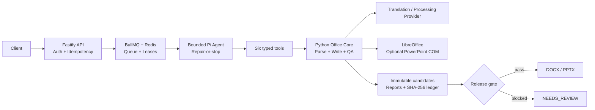

# OfficeGuard Agent

> 面向 Word / PowerPoint 的可验证、受约束文档翻译与自修复 Agent。

**状态：Late Alpha。** 仓库已经提供可重复执行的 portable CI、20 场景公开策略评测、三路径离线 Demo、脱敏 trace 与单 Redis 实例集成测试；真实 Pi/模型质量、渲染级 Office 质量、生产多副本和负载指标仍是独立的未完成证据层。当前版本不应描述为生产就绪。

## 30 秒了解项目

Office 文档翻译的难点不只是生成译文，还要同时保住语义、占位符、OOXML 结构和页面布局，并在修不好的时候拒绝交付。OfficeGuard 将系统拆成三个职责明确的层次：

- **受约束 Agent 决策层**：Pi Agent 只能基于已持久化的 QA 证据，在有限预算内选择继续修复或停止。
- **确定性执行层**：Python Core 独占 Word/PPT 解析、写回、QA 和候选管理；模型不能直接修改文件。
- **发布门禁层**：只有完整复验通过的不可变候选才能发布；残留 blocker 进入 `NEEDS_REVIEW`。

输入支持 `.doc`、`.docx`、`.ppt`、`.pptx`，交付格式为 `.docx` 或 `.pptx`，并附结构化 QA 报告。项目不包含 PDF 流程。

## 为什么是 Bounded Agent

这里的 Agent 不是一段替代流水线的 Prompt。任务状态、六个工具的权限、候选代际、修复预算、超时和发布条件都由代码强制；Agent 只处理“依据当前证据，是否值得再修一轮”这类动态决策。当前 Pi 不生成任意 OOXML 操作，Python Core 只会从 QA 结果推导白名单修复动作。

这条边界保留了 Agent 的推理空间，也把文件写入、哈希校验和发布等高风险副作用留在可测试、可审计的程序中。

## 架构与状态机



```text
QUEUED → PREFLIGHT → TRANSLATING → QA → REPAIRING → VERIFYING
                                                       ├─→ COMPLETED
                                                       ├─→ COMPLETED_WITH_WARNINGS
                                                       └─→ NEEDS_REVIEW / FAILED
```

Agent 只拥有 `preflight_document`、`translate_once`、`run_document_qa`、`apply_repair`、`verify_candidate`、`finalize_result` 六个带类型的业务工具。默认最多修复两轮，硬上限三轮；任何新候选都必须重新执行完整 QA。

## 工程与安全不变量

- Agent 没有 Shell、任意文件读写、编辑、搜索或真实路径工具，只接收 opaque candidate ID。
- Python 子进程使用固定参数和 `shell: false`；服务过滤密钥环境变量，安全日志不记录文档正文、Prompt 或模型响应。
- 原件及每轮候选不可变；输入、候选、QA、验证和最终下载文件均通过 SHA-256 绑定。
- 新候选只有在质量严格改善且没有新增 blocker 时才会晋级，否则保留当前最佳候选。
- API 层实现幂等键、取消、软/硬截止时间、同任务 single-flight 和分阶段恢复。
- `NEEDS_REVIEW` 是预期的安全终态，不能通过结果接口下载，也不会被包装成成功。

更完整的契约见 [Sidecar API 与安全边界](translation_core/pi_agent/README.md)、[Agent Skill 状态机](document-translation/SKILL.md)、[QA/修复门禁](translation_core/QA_REPAIR_AGENT.md) 和 [威胁模型](docs/security/threat-model.md)。

## 可公开复现的证据

| 证据层 | 当前可验证内容 | 明确不代表 |
| --- | --- | --- |
| Portable CI | Python lint/contract tests、TypeScript build/Vitest、可重复 release package | Office 桌面兼容性或生产部署验收 |
| 20 场景策略评测 | 同一冻结 corpus 上比较 `no_repair`、固定两轮和 bounded policy；生成 JSON/Markdown 报告 | 真实模型、真实修复算法或人工翻译准确率 |
| P1-A 三路径 Demo | 直通、候选晋级、预算耗尽 fail-closed；Python Core QA 与候选哈希可重放 | Pi session、LLM repair 或生产 uplift |
| Public Trace v1 | 严格 allowlist、schema 校验、文本 replay 和本地静态 Viewer | 完整私有 trace、Prompt 或文档内容的公开 |
| Redis integration CI | 单个真实 Redis 7.4.10 服务上的幂等竞争、队列去重、终态重投保护和重连 | 多主机、多副本、故障转移、吞吐或端到端 Exactly Once |
| 私有 75 文件压力快照 | 发布覆盖率、问题分布和一个有界修复案例的脱敏聚合 | 第三方可重放的 gold-set 质量基准 |

### 公开 20 场景策略评测

先完成下方依赖安装，再从 `translation_core/pi_agent` 运行：

```bash
npm run eval:public
```

命令会在运行时生成 CC0 合成 DOCX/PPTX fixture，并写出：

```text
translation_core/tmp/public-agent-eval/
  eval-summary.json
  eval-report.md
  corpus/fixture-index.json
```

当前冻结合同 `officeguard-public-policy-eval@1.0.0` 的结果如下（仓库同时保留 [JSON baseline](evals/baselines/v1.0.0/eval-summary.json) 与 [Markdown baseline](evals/baselines/v1.0.0/eval-report.md)）。候选轨迹、blocker 和 semantic/layout oracle 都是 manifest 中的合成标注；运行时 OOXML 只是确定性的 carrier artifact，本评测不调用原生 Office QA。`conditional risk` 只以已发布场景为分母；它仍非零，特意暴露冻结 blocker 观测未覆盖的 oracle 风险，而不是把策略 replay 包装成质量认证。

| 策略 | Release coverage | Conditional risk | Repair uplift | New regression rate | 平均修复轮数 |
| --- | ---: | ---: | ---: | ---: | ---: |
| `no_repair` | 20.0% | 50.0% | 0.0% | 0.0% | 0.00 |
| `fixed_two_round` | 70.0% | 35.7% | 62.5% | 10.0% | 1.20 |
| `bounded_agent` | 55.0% | 27.3% | 43.8% | 0.0% | 1.00 |

这项评测固定 `pi_session=false`、`model_calls=0`、`total_tokens=0`、`estimated_cost_usd=0`。延迟字段是冻结 replay 数据，不是线上性能测量。固定两轮策略的覆盖率更高，但 conditional risk、new regression 和修复轮数也更高；这里呈现的是选择性权衡，不是 bounded policy 全面胜出。CI 会重新生成 corpus 与三份报告，并检查场景数、许可和证据边界。

### P1-A 三路径与公开 trace

```bash
cd translation_core/pi_agent
npm run demo:p1a
npm run trace:export:p1a
npm run trace:validate -- ../tmp/p1a-public-traces/p1a-direct-docx.json
npm run trace:replay -- ../tmp/p1a-public-traces/p1a-high-risk-pptx.json
```

`demo:p1a` 重放直通 DOCX、一次修复后发布的 PPTX，以及修复预算耗尽后返回 `NEEDS_REVIEW`/HTTP 409 的 PPTX。`trace:export:p1a` 再通过 allowlist 投影生成 Public Trace v1；导出内容不含正文、译文、Prompt、模型响应、凭据或本机绝对路径。

直通 DOCX 使用固定翻译 Provider，但实际穿过 Python Core 的写回、QA、验证和发布；两条 PPTX repair 路径使用脚本化不可变候选，每个候选仍会由 Python Core 注册、哈希校验并执行原生 QA。三条路径都固定 `pi_session=false`、`model_calls=0`。完整证据边界见 [P1-A 三路径离线 Demo](docs/p1a-offline-demo.md)。

启动零依赖静态 Viewer：

```bash
npm run trace:viewer
```

然后打开 <http://127.0.0.1:4173>。Viewer 用于查看仓库内的脱敏样例或选择本地 Public Trace JSON；浏览器不会上传所选文件。它不是遥测后端，也不会补造未记录的 token、成本或耗时。

### Redis/BullMQ 证据边界

[Redis integration workflow](.github/workflows/redis-integration.yml) 在单个 CI runner 和真实 Redis 7.4.10 服务上验证：12 个客户端竞争同一幂等键只创建一个业务任务；并发 reconciliation 依赖 BullMQ `jobId` 去重；真实 worker 可完成 deterministic fixture 工具链；保留任务被再次投递时，终态门禁阻止工具和业务记录重复生效；ioredis 连接被 `CLIENT KILL` 后可重连并重新读取持久任务。

BullMQ 的交付语义仍是 **at-least-once**。上述测试只证明已覆盖的终态重投场景具有 effectively-once effects，不构成端到端 Exactly Once 声明，也没有验证网络分区、Redis failover/cluster、worker 副作用与状态提交之间的崩溃窗口、多副本共享存储或生产负载。

## Quick Start

Portable gate 不需要 Redis、Office 桌面程序、模型服务或 API Key。需要 Python 3.12、`uv` 和 Node 22.19.0：

```bash
cd translation_core
uv sync --frozen --extra dev --python 3.12
uv run --frozen --extra dev ruff check src tests tools
uv run --frozen --extra dev pytest -m "not office_integration"

cd pi_agent
npm ci --ignore-scripts
npm run build
npm test
```

真实 `.doc` / `.ppt` 归一化测试被标记为 `office_integration`，需要安装 LibreOffice 后单独运行。其余 portable tests 使用运行时生成的最小 Office fixture 或内存替身。固定版本和完整命令见 [CI workflow](.github/workflows/ci.yml)。

部署形态的 Sidecar 还需要 Redis、LibreOffice、翻译/处理 Provider 和 Pi 模型配置，见 [预生产部署方案](translation_core/PI_AGENT_DEPLOY.md)。

## 当前私有压力快照

最近一次本地私有压力集只公开脱敏聚合，不公开原始 Office 文件或完整 trace。它验证工程门禁和问题分布，不等同于人工翻译准确率，也不能与输入哈希、Provider 路由不同的历史批次直接比较。

| 指标 | 当前证据 |
| --- | ---: |
| Stress Set | 75 份 Office 文件 |
| 可正式交付（release coverage） | 16 / 75（21.3%） |
| `NEEDS_REVIEW` | 52 / 75（69.3%） |
| `FAILED` | 7 / 75（9.3%） |
| P0 / P1 问题 | 8 / 2,413 |
| PPTX overlap + overflow | 2,110 / 2,413 P1（87.4%） |
| 单个 PPTX 两轮修复 | 576 → 406 blocker（减少 29.5%） |

单样本修复没有新增或恶化 rendered blocker，但仍有 406 个 blocker，因此正确终止为 `NEEDS_REVIEW`。口径、来源与限制见 [脱敏评测基线](docs/evaluation-baseline.md)。

## Known Limitations

- 公开 20 场景评测是合成、离线的策略 replay；其 oracle 和延迟均为冻结数据，不能替代 live model、真实 repair、人工金集或性能测试。
- P1-A 的两条 PPTX repair 路径验证的是候选/QA/晋级/预算合同，候选不是由真实 Pi 或版式修复算法生成。
- 私有压力集 release coverage 只有 21.3%，主要瓶颈是 PPTX 文本重叠与溢出；目前没有人工 gold translation 或 coverage-risk 曲线。
- Linux 只有 LibreOffice 包可打开性门禁，没有 PowerPoint COM 的精确文本边界能力；严格模式会 fail closed。
- Redis CI 是单 runner、单 Redis 服务的定向集成测试；尚未验证多进程/多主机 worker、网络分区、故障转移、持久化丢失、长时间 soak、20 文档吞吐或 P95。
- Docker/Compose 基础镜像仍使用可变 tag；正式 release 前需固定并复核 digest。Redis 7.4 使用 RSALv2/SSPL，若发行目标要求完整 OSI 开源栈，应评估 Valkey。
- 小规模真实模型探索仅存在于私有本地证据中；公开命令全部明确标记 `model_calls=0`，不能据此声称模型质量或成本已经验证。
- 原始评测文档和完整运行日志可能包含隐私、许可或本机路径，不随仓库分发；Public Trace 只保留 allowlist 字段。

## 下一步验证优先级

1. 建立人工标注的小金集，报告 semantic/layout pass、coverage-risk、成本与延迟。
2. 在冻结 Provider/model/Prompt 版本后增加真实 Pi 策略对照，并与离线 replay 严格分层。
3. 优先治理 PPTX overlap/overflow，补齐 shape 级归因、动作收益排序和回归隔离。
4. 在 Linux + Redis 目标环境执行多进程恢复、故障注入、共享存储、并发与 soak；在可信 Windows runner 单独验证 PowerPoint COM。

更细的验收标准与演进记录见 [工程演进计划](docs/interview-roadmap.md)。

## Repository Layout

```text
translation_core/
  src/format_translator/  # 确定性 Office Core、QA、修复与工具桥
  pi_agent/               # Fastify + BullMQ + bounded Pi runtime
  tests/                  # Python contract / regression tests
  deploy/linux/           # 容器与 Compose 蓝图
document-translation/     # Agent Skill、状态机与工具契约
evals/                    # 版本化公开策略评测 manifest
trace-viewer/             # Public Trace v1 静态查看器与脱敏样例
docs/                     # 架构、ADR、安全与评测证据
```

## Documentation

- [XML + LLM 翻译框架设计](docs/xml-llm-translation-framework.md)
- [P1-A 三路径离线 Demo](docs/p1a-offline-demo.md)
- [Public Agent Eval 合同](evals/README.md)
- [Public Trace 与静态 Viewer](trace-viewer/README.md)
- [脱敏评测基线](docs/evaluation-baseline.md)
- [核心实现说明](translation_core/README.md)
- [Pi Sidecar API 与安全边界](translation_core/pi_agent/README.md)
- [当前验证边界](translation_core/PI_AGENT_VALIDATION.md)
- [工具权限矩阵](docs/security/tool-permission-matrix.md) 与 [威胁模型](docs/security/threat-model.md)
- [架构决策记录](docs/adr/)
- [Linux 能力与部署](translation_core/deploy/linux/README.md)
- [首次公开发布检查清单](docs/public-release-checklist.md)

## License 与语料政策

代码采用 [MIT License](LICENSE)。真实客户或公开下载的 Office 文件、原始验证工作区、模型响应和凭据均不提交；公开 Demo 与 20 场景评测只使用运行时生成的合成语料。
